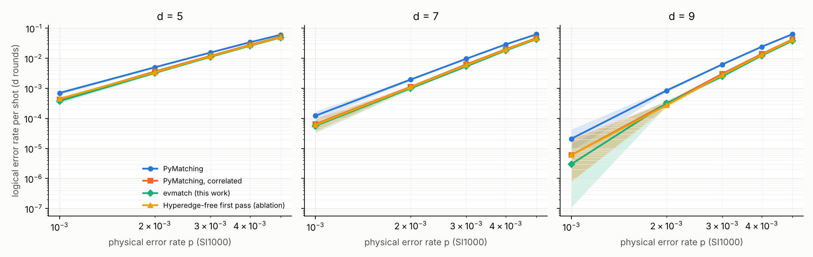
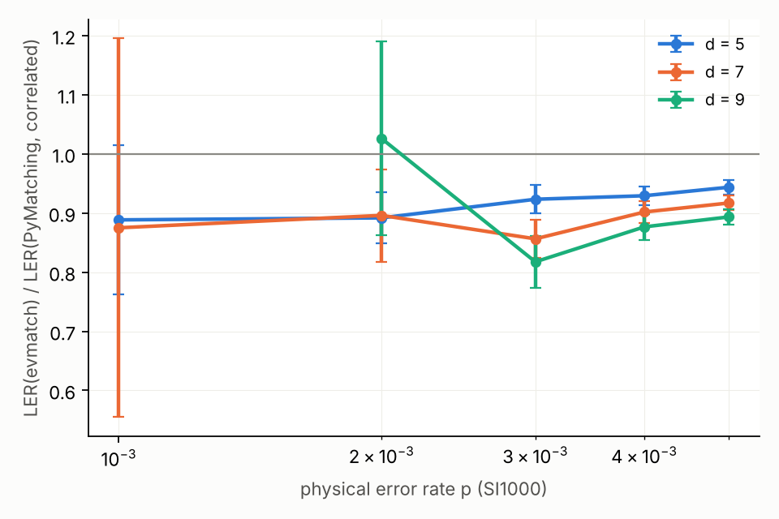

# evmatch

**Evidence-conditioned correlated matching**: a surface-code decoder for
circuit-level noise. It plugs into [sinter](https://pypi.org/project/sinter/)
and is built on PyMatching's sparse blossom.

Under SI1000 noise, at distances 5–9, evmatch has **7–17% fewer logical
errors than PyMatching's correlated mode** (PyMatching ≥ 2.3,
`enable_correlations=True`). It matches the reference belief-matching
implementation at d = 5 and 7 and beats it at d = 9, at **4.6–7.2× the time
of uncorrelated PyMatching**. Belief-matching costs roughly 1000×.



## Why

Matching decoders split each error mechanism of the detector error model into
graph edges. A Y error on a data qubit becomes an X-graph edge plus a Z-graph
edge, and each edge then carries the mechanism's full probability. But if the
Z part would have flipped X-type detectors and none of them fired, the Y error
practically did not happen. Its probability should not make the X part look
cheap. PyMatching's correlated mode only uses *positive* evidence: after a
first matching, it lowers the weights of edges correlated with the edges it
chose. evmatch also uses the *negative* evidence, locally and in
O(#detection events) per shot:

1. The base graph carries only single-edge mechanisms.
2. A multi-edge mechanism gets its probability back, on its edges, only when
   every one of its edges touches a detection event.
3. Match, trace the matched paths, apply PyMatching's correlated reweighting
   for those paths, and match again.

Weights are overwritten in place and restored after each shot. The details
and the variants are in [docs/method.md](docs/method.md), and prior work is
discussed in [docs/prior_art_evidence.md](docs/prior_art_evidence.md).

## Results

Rotated surface-code memory (Z basis, d rounds) under SI1000 noise
(Gidney, Newman & McEwen 2022). The circuit is Stim's `rotated_memory_z` with
each CX compiled to H·CZ·H; see [`src/evmatch/circuits.py`](src/evmatch/circuits.py).

**Paired comparison against correlated PyMatching.** Both decoders decode the
same shots. The ±2σ intervals come from the discordant shots (McNemar).

| d | p | shots | errors, PyMatching correlated | errors, evmatch | ratio ± 2σ | McNemar p | time / PyMatching |
|---|---|---|---|---|---|---|---|
| 5 | 0.3% | 400,000 | 4813 | 4448 | 0.924 ± 0.017 | 5e-20 | 4.9x |
| 5 | 0.5% | 400,000 | 20773 | 19410 | 0.934 ± 0.008 | 2e-61 | 4.6x |
| 7 | 0.3% | 400,000 | 2517 | 2230 | 0.886 ± 0.026 | 9e-19 | 5.1x |
| 7 | 0.5% | 400,000 | 18615 | 17127 | 0.920 ± 0.010 | 4e-62 | 4.8x |
| 9 | 0.2% | 2,000,000 | 616 | 529 | 0.859 ± 0.051 | 3e-08 | 6.6x |
| 9 | 0.3% | 400,000 | 1210 | 1010 | 0.835 ± 0.040 | 2e-16 | 5.9x |
| 9 | 0.5% | 400,000 | 16950 | 15029 | 0.887 ± 0.011 | 5e-97 | 4.8x |

**Sinter, 10⁶ shots per point.** The grid is d ∈ {5, 7, 9} and
p ∈ {0.1, …, 0.5}%, with confidence intervals; the full table is
[results/main_table.md](results/main_table.md). Each decoder samples its own
shots there, so differences of about 10% are within noise at the low-count
points. One example is d = 9, p = 0.2%, where evmatch was 317 vs 309 in sinter;
the paired run above, with 2M shots, gives 529 vs 616.



**Belief-matching reference.** This is the `beliefmatching` 0.2.0 package
with 20 BP iterations, compared on the same shots.

| d | p | shots | evmatch | belief-matching | McNemar p |
|---|---|---|---|---|---|
| 5 | 0.3% | 100,000 | 1096 | 1132 | 0.15 |
| 5 | 0.5% | 100,000 | 4761 | 4696 | 0.17 |
| 7 | 0.3% | 50,000 | 290 | 309 | 0.24 |
| 7 | 0.5% | 50,000 | 2148 | 2180 | 0.41 |
| 9 | 0.3% | 25,000 | 70 | 110 | 9e-6 |
| 9 | 0.5% | 25,000 | 937 | 971 | 0.23 |

At d = 9, p = 0.3%, the reference belief-matching was worse than correlated
PyMatching as well (85 errors on the same shots). The package's shortcut of
returning BP's own solution when BP converges is not the cause: disabling it
gives the same 110 errors, and 30 BP iterations (as in the belief-matching
paper) give 104. An independent implementation (`proto-bm20` in
`bench/proto.py`: one decomposition per symptom, log-odds weights) gives 107
here and 972 at p = 0.5%, so this is a property of belief-matching with
parallel BP on this circuit, not of the package.

**Where the gain comes from** (paired, d = 9, p = 0.3%, 400k shots):

| decoder | errors |
|---|---|
| PyMatching, correlated | 1210 |
| + one decomposition per symptom ("fewest") | 1184 |
| + first pass without hyperedges, no evidence (Harmony-style) | 1141 |
| + evidence gate in both passes (**evmatch**) | 1010 |

Times are single-threaded, on a cloud vCPU, for the same pre-sampled shots
(`bench/timing.py`, raw data in [results/timing.csv](results/timing.csv)).
Over the whole grid evmatch runs at 4.6–7.2× PyMatching and 1.7–2.2×
correlated PyMatching.

## Install

Prebuilt wheels (Linux x86_64, macOS arm64/x86_64, Windows; CPython 3.10–3.13)
are attached to the [releases](https://github.com/JimmyCarvalho/evmatch/releases):
download the one for your platform and `pip install` it. Or build from source
(needs a C++20 compiler):

```sh
pip install git+https://github.com/JimmyCarvalho/evmatch
```

The only runtime dependencies are numpy, stim and sinter. PyPI publication is
pending (`pip install evmatch` will work once it is published).

## Use

From Python:

```python
import sinter
import evmatch

tasks = [
    sinter.Task(circuit=evmatch.surface_code_si1000(d, p), json_metadata={"d": d, "p": p})
    for d in (5, 7, 9) for p in (0.002, 0.003, 0.005)
]
stats = sinter.collect(
    num_workers=4,
    tasks=tasks,
    decoders=["evmatch", "pymatching-correlated"],
    custom_decoders=evmatch.sinter_decoders(),
    max_shots=1_000_000,
)
```

From the command line:

```sh
sinter collect --circuits *.stim --decoders evmatch \
    --custom_decoders_module_function "evmatch:sinter_decoders" \
    --max_shots 1000000 --processes 4 --save_resume_filepath stats.csv
```

To decode directly:

```python
dem = circuit.detector_error_model(decompose_errors=True)
decoder = evmatch.EvMatchDecoder().compile_decoder_for_dem(dem=dem)
predicted_observables = decoder.decode_batch(detection_events)  # (shots, num_detectors) bools
```

The DEM must be built with `decompose_errors=True`. At most 64 observables
are supported.

## Reproduce

```sh
pip install -e ".[bench]"          # adds pymatching, beliefmatching, ldpc, scipy, matplotlib
python bench/collect.py --decoders pymatching pymatching-correlated --save results/baseline_pm.csv
python bench/collect.py --decoders evmatch nat-single-correlated --save results/main.csv
python bench/paired.py --decoders pymatching-correlated evmatch --d 5 7 9 --p 0.003 0.005 --shots 400000
python bench/timing.py --decoders pymatching pymatching-correlated evmatch --out results/timing.csv
python bench/table.py results/baseline_pm.csv results/main.csv
python bench/plot.py results/baseline_pm.csv results/main.csv --out results/ler.png --ratio-out results/ratio.png
```

`logs/compute.log` records when each run happened. The development history,
including prototypes and dead ends, is in `bench/proto.py` and `logs/`.

## Limitations

- **Coverage:** only the rotated surface-code memory, Z basis, d ≤ 9 and
  SI1000 noise have been tested. Other codes and noise models should work
  (the method only reads the DEM) but have not been measured.
- **Circuit:** it is not Google's hardware circuit; small differences in the
  schedule change absolute numbers.
- **Low-p statistics:** at p = 0.1% even 10⁶ shots give only a handful of
  errors at d = 9.
- **Timing:** single-machine, single-threaded measurements; ratios are more
  meaningful than absolute times.

## Releasing

Pushing a branch `release/vX.Y.Z` (or a tag `vX.Y.Z`) builds the wheels and
the sdist, creates the tag and attaches them to a GitHub release
(`.github/workflows/release.yml`) and uploads to PyPI by trusted publishing,
which needs a pending publisher on pypi.org (project `evmatch`, owner
`JimmyCarvalho`, repository `evmatch`, workflow `release.yml`, environment
`pypi`). Without it the upload step fails and the GitHub release is still made.

## License and credits

Apache-2.0. The matching core is PyMatching's sparse blossom (Higgott &
Gidney, arXiv:2303.15933), vendored unmodified; see [NOTICE](NOTICE).
Correlated reweighting follows Fowler (arXiv:1310.0863) and PyMatching's
implementation. SI1000 is from Gidney, Newman & McEwen, Quantum 6, 813 (2022).
